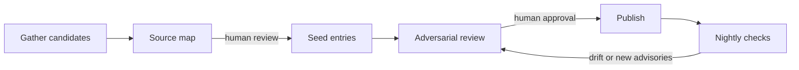

# Methodology

How entries in this compendium are found, checked and kept current. The inclusion rules themselves are in [CONTRIBUTING.md](CONTRIBUTING.md).

## Pipeline

1. **Gather.** Candidates come from the MCP specification and its maintainers, standards bodies (OWASP, CoSAI, IETF), government guidance (NSA), research labs, academic papers (arXiv, with peer-reviewed versions where they exist), and advisory databases (GitHub Security Advisories, OSV).
2. **Source map.** Every candidate is listed with its section, author, strongest signal and a proposed keep or drop. A maintainer decides each row before anything is written. Rows that depend on a check carry a condition, and the row is dropped if the check fails.
3. **Seed.** Each kept row becomes one entry file in `data/entries/`, checked against the schema in `schema/entry.schema.json`.
4. **Adversarial review.** A separate pass looks for reasons each entry should not be listed (see below). A maintainer approves every change.
5. **Publish.** `README.md` is generated from the data by `scripts/generate.py`. Nobody edits it by hand.

## Verification

An entry is "verified" when its facts were read from the source itself, not from a summary of it:

- **Repositories:** the GitHub API for stars, contributors, creation and push dates, license, archived status and the current name (renamed repos link to their new path).
- **Pages and posts:** the page HTML for title, author and date.
- **Papers:** the arXiv record for authors and affiliations, and Crossref for the peer-reviewed version. A preprint counts as a strong signal only if it released its code.
- **Advisories:** the OSV record, or the GitHub repository advisory when OSV has none. Each record also carries a short summary written for this list.
- **Dead links:** an archived copy from the Wayback Machine, when the original page is gone or now redirects elsewhere.

Each entry records the date it was last verified.

## Adversarial review

Each entry is checked for:

- **Signal manipulation:** star spikes, sock-puppet or bot contributors, signals that don't meet the thresholds.
- **Impersonation:** forks, typosquats, lookalike domains, or a renamed repo whose old path now belongs to someone else.
- **Unsupported claims:** a description or date the source doesn't back up.
- **Status:** withdrawn advisories, vendor disputes, archived projects, or content made obsolete by the 2026-07-28 specification.
- **Install path:** what the documented install runs, and what the tool sends off the machine by default.
- **Marketing:** product pages presented as research.

## Topic rules

These differ from the defaults used across compendiums:

- **Star threshold:** 300 stars counts as a strong signal, not 500, because MCP tooling dates from late 2024.
- **CVE scope:** advisories in MCP SDKs, servers, clients and gateways are included. Advisories in general agent tools are included only when the root cause is in MCP handling (configuration, transport, authorization or tool output), not when MCP is only the payload.
- **Unreachable sources:** if a primary source can't be reached, the entry stays only when the issuer has very high reputation, such as a government agency or standards body. Other dead vendor posts are linked through an archived copy or replaced by the advisory; otherwise they are dropped.
- **Deprecated features:** research on features the 2026-07-28 specification deprecates (sampling, sessions, dynamic client registration) stays listed, and its description says so.
- **Threat tags:** entries carry [CoSAI](https://www.coalitionforsecureai.org/wp-content/uploads/2026/03/model-context-protocol-security-1.pdf) threat categories `T1`–`T12` as a shared vocabulary across sections.

## Numbers

| Stage | Result |
|---|---|
| Candidates gathered (2026-10-17) | 100 sources, 68 advisories |
| Source map review (2026-10-28) | 68 kept, 1 merged, 31 dropped |
| Seeding (2026-10-28) | 64 entries; 4 dropped on failed checks, 1 merged |
| CVE tracker (seeding) | 65 advisories; 3 excluded by the scope rule |
| Adversarial review (2026-10-28) | 54 findings: 2 entries dropped, 24 entries corrected, 1 exclusion reversed, 2 advisories added |
| Published set | 62 entries, 68 advisories; 2 excluded (`data/cve-exclusions.json`) |

## Limits

- Star history could not be checked during seeding: GitHub's stargazer listing returned 404 for every repository on 2026-10-28. Where star history mattered, the stars signal was left out and the entry rests on its other signals.
- `published` for repositories is the creation date, since many projects have no dated release.
- The review relies on public sources. It can't detect undisclosed affiliations between authors and the projects they write about.
